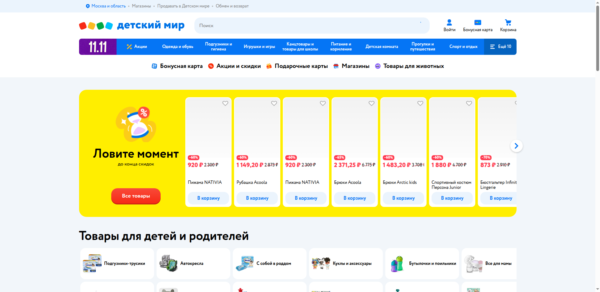

# Отчёт по практическому занятию 10

**Дисциплина:** Тестирование программного обеспечения  
**Тема:** Тестирование вёрстки web-приложения. Pixel Perfect, DevTools, Lighthouse  
**Студент:** вариант 0  
**Дата выполнения:** 03.11.2026  
**Объект проверки:** https://www.detmir.ru/ (тот же сайт, что в практике 0 — smoke)  
**Рабочая папка:** `Тестирование/10/`

---

## 1. Цель работы

Проверить соответствие вёрстки макету/гайду с помощью **Chrome DevTools** (размеры, отступы, шрифты, цвета) и оценить качество страницы через **Lighthouse**.

---

## 2. Инструменты

| Инструмент | Применение |
|------------|------------|
| Chrome DevTools → Elements → Computed | Ширина/высота, padding, font-size, color |
| PerfectPixel (расширение) | Наложение PNG-макета (если выдан преподавателем) |
| Lighthouse | Performance, Accessibility, Best Practices, SEO |

---

## 3. Замеры главной страницы

Сайт: https://www.detmir.ru/  
Снято на GitHub Actions, Chrome headless, 7 ноября 2026. Макет PNG/Figma в материалах задания не приложен, поэтому таблица сравнивает страницу с требованиями доступности и с шириной вьюпорта, а не с пикселями чужого UI-kit. Сырые числа: `screenshots/measured.json`.

| № | Элемент | Ожидание | Факт | Разница |
|---|---------|----------|------|---------|
| 1 | Заголовок `h1` | один заголовок страницы | элемента `h1` нет | страница без `h1` |
| 2 | Фон `body` | светлый фон | `rgb(255, 255, 255)` | совпадает с белым |
| 3 | Шрифт страницы | системный или брендовый | `Circe, sans-serif` | шрифт подключился |
| 4 | Высота `header` на 1920×1080 | компактная шапка | 176 px | высокая шапка на десктопе |
| 5 | Горизонтальный скролл, 375×812 | контент внутри 375 px | `scrollWidth` 405 px | +30 px, контент выезжает |
| 6 | Подписи категорий справа на 375 px | полное название карточки | обрезка: «Авт», «Futt», «Игр и дс» | текст не помещается |
| 7 | Контраст текста | WCAG | Lighthouse: contrast = 0 | пары цветов не проходят |
| 8 | Имя у кнопок | доступное имя | Lighthouse: buttons without accessible name = 0 | часть кнопок без имени |

---

## 4. Lighthouse

`npx lighthouse` 13.6.0, 2026-11-07T12:43:10Z, JSON: `screenshots/lighthouse.json`.

| Категория | Балл |
|-----------|------|
| Performance | 34 |
| Accessibility | 83 |
| Best Practices | 73 |
| SEO | 100 |

Что тянет баллы вниз: долгое выполнение JavaScript, LCP, доставка картинок, недостаточный контраст, кнопки без доступного имени, `iframe` без `title`.

---

## 5. Выводы

На десктопе страница открывается без горизонтального скролла, фон белый, шрифт Circe. На ширине телефона контент шире вьюпорта на 30–45 px, правая колонка категорий обрезается. SEO 100, производительность 34: основной запас — картинки и JavaScript первого экрана.
