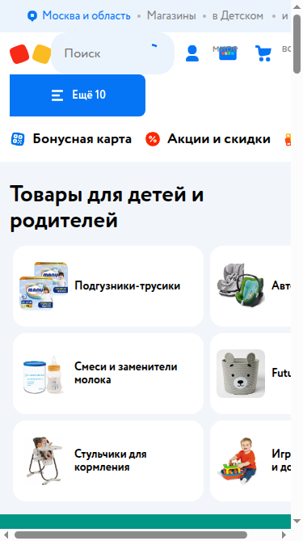
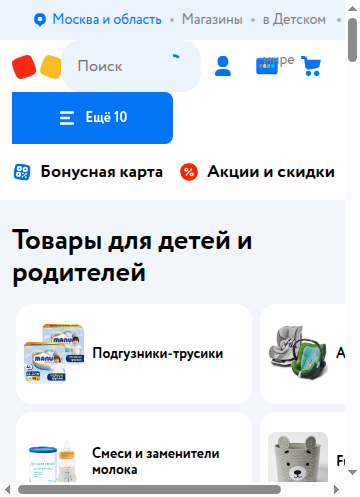

# Отчёт по практическому занятию 11

**Дисциплина:** Тестирование программного обеспечения  
**Тема:** Адаптивность и кроссбраузерность вёрстки  
**Студент:** вариант 0  
**Дата выполнения:** 03.11.2026  
**Объект:** https://www.detmir.ru/  
**Рабочая папка:** `Тестирование/11/`

---

## 1. Цель работы

Проверить отображение сайта на типовых разрешениях (DevTools **Device Toolbar**) и сравнить поведение в **Chrome**, **Firefox**, **Edge**.

---

## 2. Матрица разрешений

| Разрешение | Устройство | Скриншот |
|------------|------------|----------|
| 1920×1080 | Desktop | `screenshots/1920x1080.png` |
| 1366×768 | Laptop | `screenshots/1366x768.png` |
| 1024×768 | Tablet landscape | `screenshots/1024x768.png` |
| 768×1024 | Tablet portrait | `screenshots/768x1024.png` |
| 375×812 | iPhone X | `screenshots/375x812.png` |
| 360×640 | Android | `screenshots/360x640.png` |

*Сделать: DevTools → Toggle device toolbar → выбрать preset или Custom → Capture screenshot.*

---

## 3. Проблемы адаптивности

Замеры Chrome на https://www.detmir.ru/ , `screenshots/layout.json`. Горизонтальный выезд: `scrollWidth` больше `innerWidth`.

| Разрешение | Что видно | Скрин |
|------------|-----------|-------|
| 1920×1080 | Скролла по X нет, шапка 176 px | `screenshots/1920x1080-chrome.png` |
| 1366×768 | Скролла по X нет, шапка 176 px | `screenshots/1366x768-chrome.png` |
| 1024×768 | Скролла по X нет, шапка всё ещё 176 px | `screenshots/1024x768-chrome.png` |
| 768×1024 | Скролла по X нет, шапка сжимается до 144 px | `screenshots/768x1024-chrome.png` |
| 375×812 | `scrollWidth` 405 при ширине 375, подписи правых карточек обрезаны | `screenshots/375x812-chrome.png` |
| 360×640 | тот же выезд до 405 px, карточки справа обрезаны сильнее | `screenshots/360x640-chrome.png` |

---

## 4. Кроссбраузерность

Один и тот же URL, headless. Chrome и Edge прошли все шесть размеров. Firefox сохранил кадры 1920 и 1366, затем драйвер оборвался по таймауту (`Read timed out`), поэтому чисел по Firefox нет.

| Разрешение | Chrome, шапка | Edge, шапка | Overflow |
|------------|---------------|-------------|----------|
| 1920×1080 | 176 px | 176 px | нет / нет |
| 1366×768 | 176 px | 176 px | нет / нет |
| 1024×768 | 176 px | 144 px | нет / нет |
| 768×1024 | 144 px | 144 px | нет / нет |
| 375×812 | 144 px | 144 px | да / да |
| 360×640 | 144 px | 144 px | да / да |

Заметное отличие: на 1024×768 Edge уже переключает шапку на мобильную высоту 144 px, Chrome ещё держит 176 px. На телефонах оба браузера дают горизонтальный выезд.

---

## 5. Выводы

До 768 px вёрстка укладывается в ширину окна. На 360 и 375 px контент стабильно шире экрана (405 px) и в Chrome, и в Edge. Это дефект сетки, а не одного браузера.
