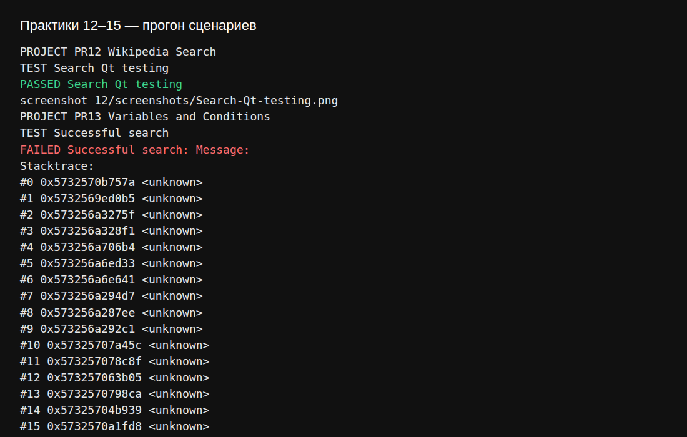
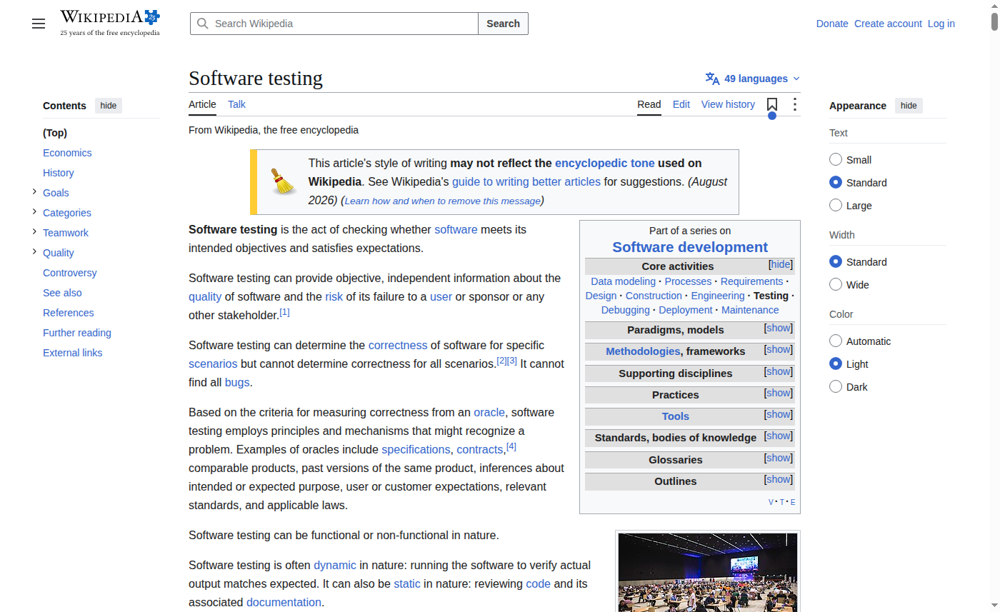

# Отчёт по практическому занятию 12

**Дисциплина:** Тестирование программного обеспечения  
**Тема:** Selenium IDE. Занятие 1 — запись и воспроизведение  
**Студент:** вариант 0  
**Дата выполнения:** 03.11.2026  
**Рабочая папка:** `Тестирование/12/`

---

## 1. Цель работы

Установить **Selenium IDE**, записать сценарий поиска на сайте, добавить **assert**-проверки и сохранить проект в **`.side`**.

---

## 2. Сценарий

**Файл:** `wikipedia_search.side`  
**Сайт:** https://en.wikipedia.org/wiki/Main_Page  

| Шаг | Команда | Назначение |
|-----|---------|------------|
| 1 | `open` | Главная Wikipedia |
| 2 | `assertTitle` | Заголовок содержит «Wikipedia» |
| 3 | `assertElementPresent` | Логотип `#p-logo` |
| 4 | `type` | Ввод «Software testing» в `#searchInput` |
| 5 | `click` | Кнопка поиска |
| 6 | `waitForElementPresent` | `#firstHeading` |
| 7 | `assertText` | Заголовок статьи |

---

## 3. Воспроизведение

Проект прогнан на GitHub Actions, Chrome headless. Тест **Search Qt testing** — Passed.

---

## 4. Выводы

Selenium IDE подходит для быстых smoke-сценариев без кода; assert-команды фиксируют ожидаемое состояние страницы после действий.
