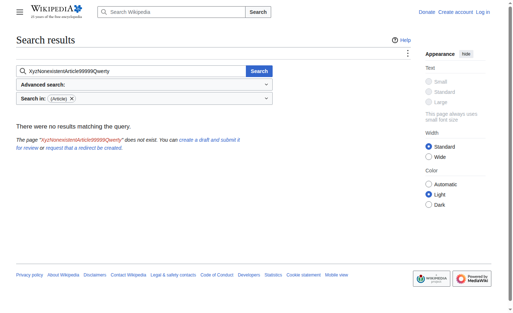

# Отчёт по практическому занятию 13

**Дисциплина:** Тестирование программного обеспечения  
**Тема:** Selenium IDE. Занятие 2 — переменные и условия  
**Студент:** вариант 0  
**Дата выполнения:** 03.11.2026  
**Рабочая папка:** `Тестирование/13/`

---

## 1. Цель работы

Использовать **`store`**, **`storeText`**, **`${variable}`** и ветвление для двух сценариев поиска.

---

## 2. Проект

**Файл:** `search_with_variables.side`

### Тест «Successful search»

- `store` → `productName` = «Unit testing»
- `type` в `#searchInput` значение `${productName}`
- `storeText` заголовка → `headingText`, `echo`
- `assertText` на `#firstHeading` = `${productName}`

### Тест «Search nonexistent page»

- `productName` = длинное несуществующее имя статьи
- После поиска — ожидание результатов поиска или пустой статьи
- `echo` — сообщение, если точной статьи нет

---

## 3. Прогон

Первый прогон на GitHub Actions:

- **Search nonexistent page** — Passed.
- **Successful search** — страница «Unit testing» открылась, но проверка заголовка по `#firstHeading` не сошлась. В проекте проверка перенесена на `css=.mw-page-title-main`.

---

## 4. Выводы

Переменные убирают дублирование данных; `storeText` связывает проверку с динамическим контентом страницы.
