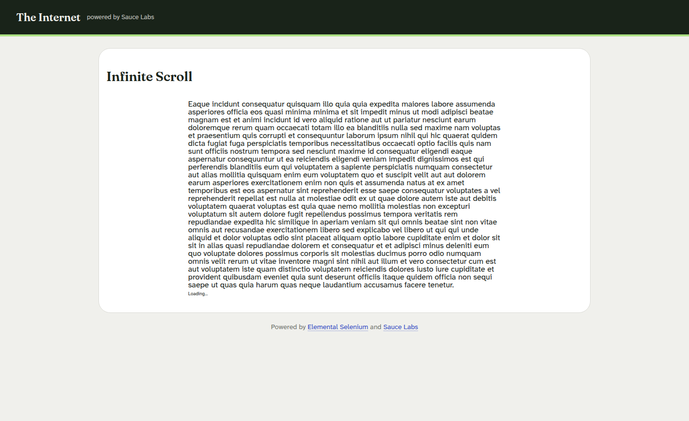
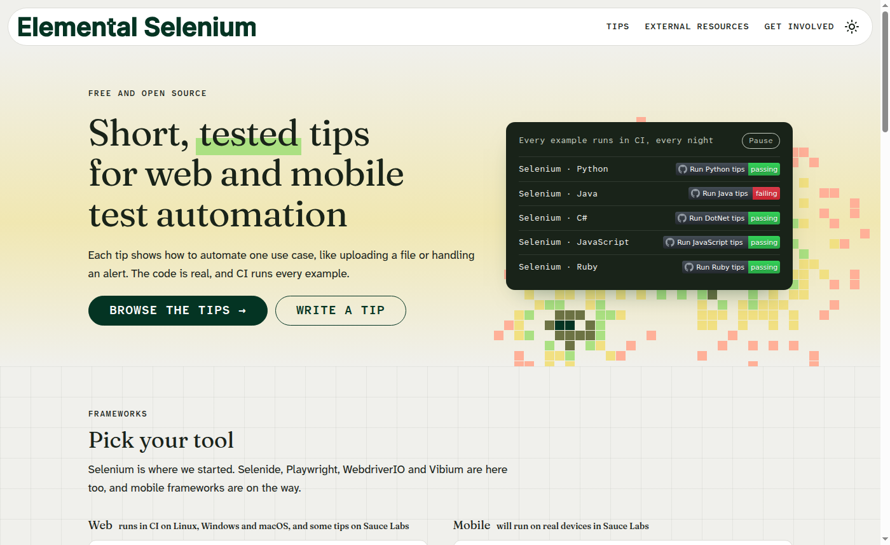
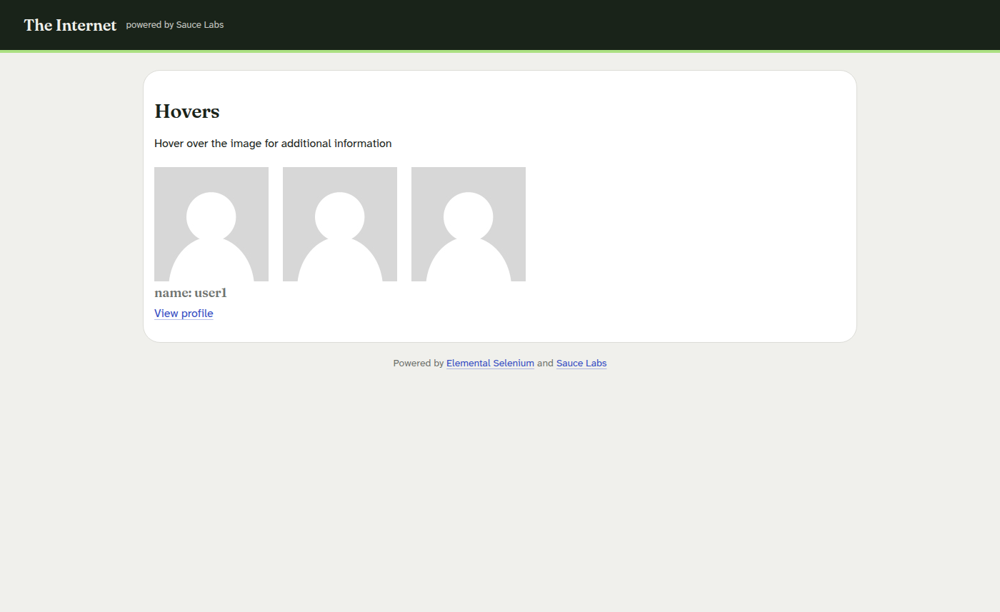

# Отчёт по практическому занятию 15

**Дисциплина:** Тестирование программного обеспечения  
**Тема:** Selenium IDE. Занятие 4 — wait-команды и динамический контент  
**Студент:** вариант 0  
**Дата выполнения:** 03.11.2026  
**Рабочая папка:** `Тестирование/15/`

---

## 1. Проект `waits_and_dynamic.side`

### Infinite scroll (`the-internet.herokuapp.com/infinite_scroll`)

| Команда | Назначение |
|---------|------------|
| `executeScript` | `scrollTo` в конец страницы |
| `waitForElementVisible` | `.jscroll-added` (timeout 8000 ms) |
| `assertElementPresent` | подгруженный блок |

### Hover (`the-internet.herokuapp.com/hovers`)

| Команда | Назначение |
|---------|------------|
| `mouseOver` | `.figure` |
| `waitForElementVisible` | `.figcaption` |
| `waitForText` | «name: user1» |
| `assertText` | текст подсказки |

---

## 2. Использованные ожидания

- **`waitForElementVisible`** — появление DOM после скролла и hover  
- **`waitForText`** — текст tooltip после анимации  
- **`pause`** не использовался (по рекомендации методички)

---

## 3. Прогон

Три теста Passed на GitHub Actions.

| Команда | Где использована |
|---------|------------------|
| `waitForElementVisible` | новый блок после прокрутки, подпись при наведении |
| `waitForText` | текст подписи и заголовок A/B Test |
| `waitForTitle` | переход на Elemental Selenium меняет `document.title` |

---

## 4. Выводы

Явные wait-команды стабилизируют тесты на AJAX и hover; фиксированные `pause` хуже масштабируются на медленных сетях.
