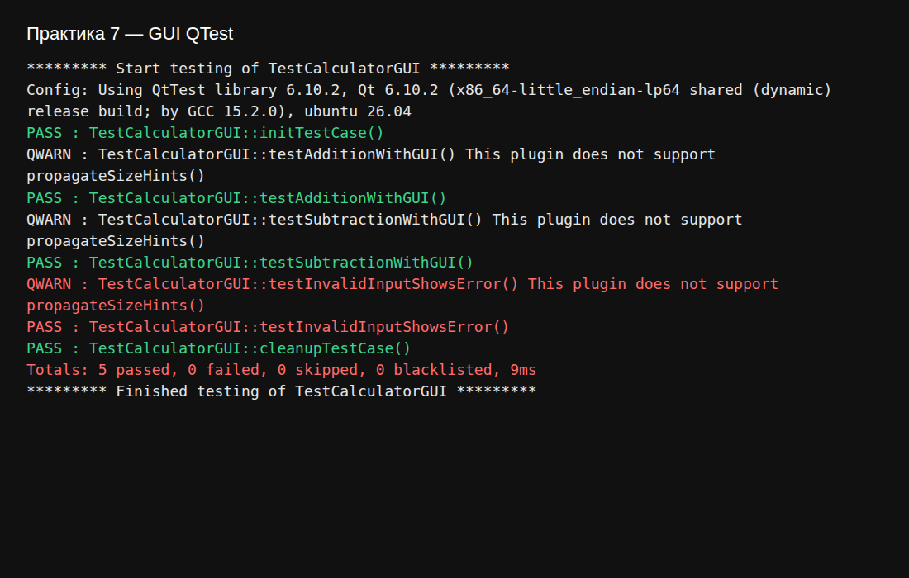

# Отчёт по практическому занятию 7

**Дисциплина:** Тестирование программного обеспечения  
**Тема:** Юнит-тестирование в Qt (QTestLib). Занятие 4 — GUI-тесты  
**Студент:** вариант 0  
**Дата выполнения:** 03.11.2026  
**Рабочая папка:** `Тестирование/7/`

---

## 1. Цель работы

Освоить эмуляцию действий пользователя в **QTestLib** (`keyClicks`, `mouseClick`) и проверку состояния виджетов калькулятора с графическим интерфейсом.

---

## 2. Приложение `MainWindow`

Виджеты с `objectName` (как в методичке):

| objectName | Тип | Назначение |
|------------|-----|------------|
| `input1`, `input2` | `QLineEdit` | Операнды |
| `addButton`, `subtractButton` | `QPushButton` | Операции |
| `resultLabel` | `QLabel` | Результат |
| `errorLabel` | `QLabel` | Сообщение об ошибке ввода |

После успешной операции поля ввода **очищаются**.

---

## 3. GUI-тесты (`TestCalculatorGUI`)

| Метод | Сценарий |
|-------|----------|
| `testAdditionWithGUI` | 15 + 7 → «22», поля пустые |
| `testSubtractionWithGUI` | 30 − 12 → «18» |
| `testInvalidInputShowsError` | «abc» + 5 → «Invalid input» |

Перед кликами вызывается `QTest::qWaitForWindowExposed(&window)`.

---

## 4. Результат прогона

GitHub Actions, Qt 6.10.2, `QT_QPA_PLATFORM=offscreen`. Лог `screenshots/remote-ctest.log`.

```
PASS   : TestCalculatorGUI::testAdditionWithGUI()
PASS   : TestCalculatorGUI::testSubtractionWithGUI()
PASS   : TestCalculatorGUI::testInvalidInputShowsError()
Totals: 5 passed, 0 failed, 0 skipped, 0 blacklisted, 9ms
```



---

## 5. Выводы

GUI-тесты на QTestLib удобны для регрессии простых форм: стабильные `objectName`, явные ожидания по тексту меток и проверка очистки полей после операции.
