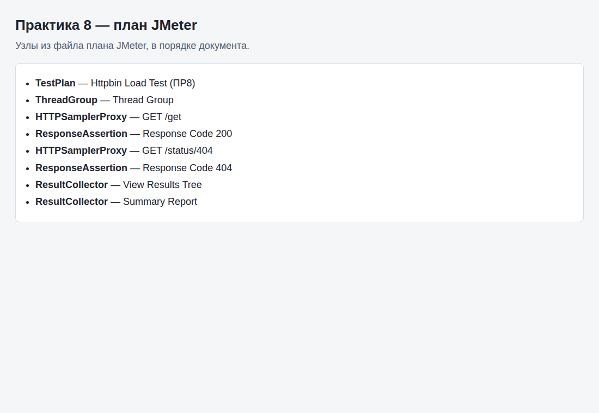
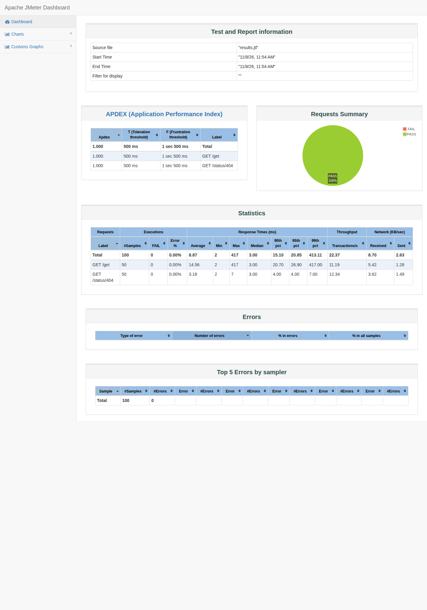

# Отчёт по практическому занятию 8

**Дисциплина:** Тестирование программного обеспечения  
**Тема:** Нагрузочное тестирование в Apache JMeter. Занятие 1  
**Студент:** вариант 0  
**Дата выполнения:** 03.11.2026  
**Рабочая папка:** `Тестирование/8/`

---

## 1. Цель работы

Создать **тестовый план JMeter** с Thread Group, HTTP Request, Response Assertion и слушателями результатов; получить базовые метрики нагрузки на публичный API.

---

## 2. Тестовый план

Файл: **`httpbin_load_test.jmx`**

| Параметр | Значение |
|----------|----------|
| Потоки (users) | 10 |
| Ramp-Up | 5 с |
| Loop Count | 5 |
| Sampler 1 | GET `https://httpbin.org/get`, assertion **200** |
| Sampler 2 | GET `https://httpbin.org/status/404`, assertion **404** |
| Listeners | View Results Tree, Summary Report |

Открытие: Apache JMeter → **File → Open** → выбрать `httpbin_load_test.jmx` → **Run**.

---

## 3. Прогон на GitHub Actions

JMeter **5.6.3**, Java 17, режим без GUI. Прогон: [Remote tests](https://github.com/Denis-Mist/TestMain/actions/runs/42373315297), 7 ноября 2026. Сводка: `ci-summary.md`.

| Label | Samples | Avg ms | Min | Max | Error % | Throughput /s |
|---|---:|---:|---:|---:|---:|---:|
| GET /get | 50 | 15 | 2 | 417 | 0.0 | 11.2 |
| GET /status/404 | 50 | 3 | 2 | 7 | 0.0 | 12.35 |
| TOTAL | 100 | 9 | 2 | 417 | 0.0 | 22.39 |

Оба assertion по коду ответа прошли: 100 запросов, 0 % ошибок.

---

## 4. Выводы

10 потоков с разгоном 5 секунд и 5 итерациями дают около 22 запросов в секунду на httpbin.org при среднем времени ответа 9 мс и 0 % ошибок. Assertion на 200 и 404 отделяет успешный ответ от ожидаемой ошибки.
