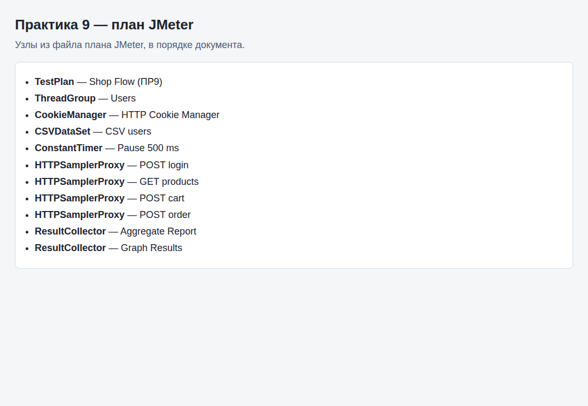
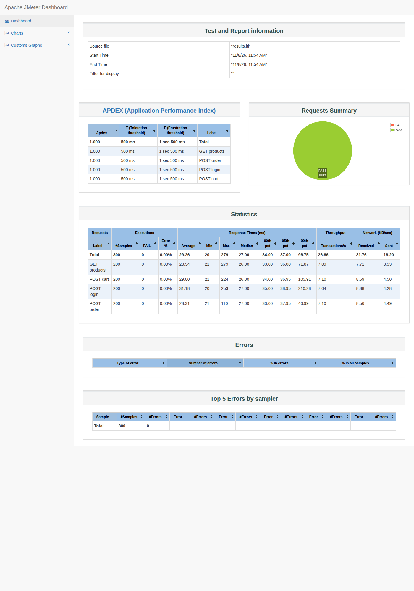

# Отчёт по практическому занятию 9

**Дисциплина:** Тестирование программного обеспечения  
**Тема:** JMeter. Занятие 2 — параметризация, сессии, анализ  
**Студент:** вариант 0  
**Дата выполнения:** 03.11.2026  
**Рабочая папка:** `Тестирование/9/`

---

## 1. Цель работы

Смоделировать сценарий «интернет-магазина» (логин → каталог → корзина → заказ) с **CSV Data Set Config**, **HTTP Cookie Manager** и анализом через Aggregate Report / Graph Results.

---

## 2. Артефакты

| Файл | Назначение |
|------|------------|
| `shop_load_test.jmx` | План: 20 потоков, ramp 10 с, 10 итераций |
| `users.csv` | 8 пар `username,password` |

**Цепочка HTTP (учебный API httpbin.org):**

1. POST `/post` — login (`${username}`, `${password}`)
2. GET `/get?action=products`
3. POST `/post` — cart (`item=sku-101`)
4. POST `/post` — order (`user=${username}`)

**Cookie Manager** включён для сохранения cookies между запросами в рамках потока.

---

## 3. Настройка CSV Data Set Config

- Filename: `users.csv` (лежит рядом с `.jmx` или укажите полный путь)
- Variable Names: `username,password`
- Recycle on EOF: **True**
- Stop thread on EOF: **False**

---

## 4. Результат прогона

JMeter 5.6.3 без GUI. 20 потоков × 10 итераций × 4 запроса = **800** samples. Стенд `postman-echo.com`: httpbin.org на этом профиле отклонял около 93 % запросов, echo-сервис держит ту же схему login → products → cart → order. Между запросами пауза 500 мс. Сводка: `ci-summary.md`.

| Label | Samples | Avg ms | Min | Max | Error % | Throughput /s |
|---|---:|---:|---:|---:|---:|---:|
| POST login | 200 | 31 | 20 | 253 | 0.0 | 7.04 |
| GET products | 200 | 29 | 21 | 279 | 0.0 | 7.1 |
| POST cart | 200 | 29 | 21 | 224 | 0.0 | 7.1 |
| POST order | 200 | 28 | 21 | 110 | 0.0 | 7.11 |
| TOTAL | 800 | 29 | 20 | 279 | 0.0 | 26.69 |

---

## 5. Выводы

Все четыре шага отработали с 0 % ошибок. Среднее время 28–31 мс, пропускная способность около 7 запросов в секунду на шаг. CSV подставляет пользователей, Cookie Manager включён в плане.
